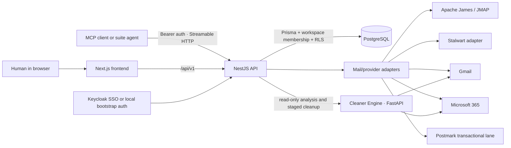

<div align="center">
  <p>
    
  </p>
  <h1>Email-Ops</h1>
  <p><strong>Agent-drafted email with a human approval inbox.</strong></p>
  <p>
    <a href="LICENSE"></a>
    <a href="CHANGELOG.md"></a>
    
    
    
  </p>
  <p>
    <a href="#quick-start">Quick start</a> ·
    <a href="#highlights">Features</a> ·
    <a href="#built-for-agents">Agents</a> ·
    <a href="#architecture">Architecture</a> ·
    <a href="#part-of-unicorn-commander">Suite</a>
  </p>
</div>

<p align="center">
  
</p>

## What is Email-Ops?

Email-Ops is the mailbox, thread, and agent-inbox surface for the Unicorn Commander suite. It gives teams a unified view of their mail, lets agents triage and draft work, and puts outbound decisions in a human approval queue. The default path is simple: agents do the preparation, people review the consequential work; higher autonomy levels are explicit and audited. It is self-hostable, workspace-scoped, and connects to the rest of the suite through shared identity and an authenticated MCP contract rather than copying mail into every cockpit.

## Highlights

- **Unified inbox:** Search, read, reply, reply-all, forward, flag, and move threads across registered mailboxes from one command-center view, so people do not have to switch between providers.
- **Assistant actions:** The streaming assistant can summarize and triage mail, stage threaded draft replies, prepare cleanup batches, and request native unsubscribes; unsubscribe runs only against an advertised target and still waits for approval.
- **Human approval inbox:** Agent-drafted email, cleanup batches, and notices land in a review queue with approve/reject decisions and audit context, so automation stays accountable.
- **Policy-controlled autonomy:** Give each agent L0 draft-only, L1 approve-to-send, or L2 autonomous-with-audit permissions, then pause an individual agent or the whole fleet when the situation changes.
- **Managed sending identities:** Register human, agent, or shared mailboxes and bind agents to the identities they are allowed to use; provisioning policy controls who may create or change them.
- **Review-only insights:** Analyze connected Gmail or Microsoft 365 inbox metadata and headers for patterns, unread volume, senders, and recommendations; the UI keeps suggested cleanup behind a review gate.
- **Suite tenancy:** Workspace membership, server-side authorization, Prisma persistence, and row-level isolation give web users and agents the same boundary.

### Data boundaries

| Email-Ops records | Email-Ops federates |
|---|---|
| Workspace mailboxes, message/thread records it creates, outbound status, agent identities, approval decisions, and policy state | The configured mail engine for mailbox data and delivery; Postmark for the transactional lane; connected Gmail and Microsoft 365 accounts for provider-backed mail and cleanup |

The app follows a “federate the engine” boundary: a suite cockpit can address Email-Ops by `workspace_id` over MCP without running a second mail server or copying a thread into its own database.

## Feature tour

### Unified inbox

<p align="center">
  
</p>

The `/mail` surface brings registered mailboxes, folders, search, thread reading, composition, and triage into one workspace view. It supports HTML mail in a sandboxed reader, attachments, bulk actions, keyboard shortcuts, pop-out reading, and an all-inboxes view. The activity rail reports server-computed agent work alongside the approval context it creates.

### Agent approvals

<p align="center">
  
</p>

The approval inbox shows the exact draft or staged cleanup action before execution. A reviewer can inspect it, approve and send or run it, reject it, and leave an audit note.

### Mailboxes and sending identities

<p align="center">
  
</p>

Mailboxes are first-class workspace records for people, agents, and shared addresses. The provisioning policy and mailbox bindings make the sending identity explicit instead of relying on a silent default.

### Agent fleet and permissions

<p align="center">
  
</p>

The Agents view makes each agent’s mailbox, autonomy level, active state, and pending work visible. The pause controls and send-path policy are designed to be understandable before an agent acts.

### Insights

<p align="center">
  
</p>

Insights provide read-only mailbox analysis for connected accounts. If the AI layer is unavailable, the service keeps the statistical view and does not silently turn recommendations into actions.

The in-app Help page documents the approval, autonomy, cleanup, integration, and keyboard-shortcut workflows from inside the cockpit.

## Built for agents

Email-Ops exposes a stateless MCP Streamable HTTP endpoint at `/api/v1/mcp`. Clients use `POST`, `GET`, or `DELETE` with a Bearer credential: a hosted Keycloak access token, a self-host local session JWT, or a scoped personal access token. Each request is handled as the authenticated caller inside the caller’s workspace membership and database isolation boundary.

Trusted suite-agent JWT federation can be enabled through the issuer and audience settings in Configuration; it still resolves to a workspace-scoped caller before a tool runs.

The server registers **68 MCP tools** at this commit. The most useful starting points are:

- Read mail with `list_threads`, `get_thread`, and `search_mail`.
- Triage with `set_disposition`, `set_sender_policy`, and `bulk_disposition`.
- Compose through `compose_email`; `mode=draft` stages the message for review and `mode=send` enters the configured delivery lane.
- Work the human gate with `list_agent_inbox`, `approve_agent_inbox_item`, and `reject_agent_inbox_item`.
- Inspect and control the fleet with `list_agents`, `pause_agent`, and `resume_agent`.
- Federate the UI with `ui_navigate`, `ui_open_thread`, `ui_compose`, `ui_switch_space`, and `ui_notify`.

The cross-app EmailOpsPort contract is `list_threads_with_contact`, `list_thread_messages`, and `compose_email`. Responses include MCP structured content, and compose is idempotent on the caller-provided external source/reference tuple. Reads are workspace-scoped; send and approval operations still pass the server-side entitlement and policy gates.

The agent hook implemented here is MCP federation plus the `ui_*` command surface. The repository also publishes an MCP discovery manifest so a suite coordinator can learn the endpoint and advertised tool catalog without receiving a user credential.

### Connect a client

Replace the angle-bracket placeholders with the host and PAT you deliberately configured for the target workspace:

```bash
claude mcp add --transport http email-ops \
  https://<email-ops-host>/api/v1/mcp \
  --header "Authorization: Bearer <eo_pat>"
```

See [docs/MCP.md](docs/MCP.md) for token minting, PAT scopes, the EmailOpsPort contract, and the complete tool reference.

## Quick start

### Docker self-host

This profile starts the frontend, NestJS API, and PostgreSQL. It deliberately leaves hosted SSO, a live mail engine, Postmark, and the optional Cleaner Engine unconfigured, so the local approval and tenancy surfaces can be explored without inventing provider credentials.

Requirements: Docker with Compose, `curl`, and `openssl`. The PAT example also uses `jq`.

```bash
git clone https://github.com/Unicorn-Commander/Email-Ops.git
cd Email-Ops
cp .env.selfhost.example .env.selfhost

export POSTGRES_PASSWORD="$(openssl rand -hex 24)"
export APP_DB_PASSWORD="$(openssl rand -hex 24)"
export JWT_SECRET="$(openssl rand -hex 32)"
export BOOTSTRAP_ADMIN_EMAIL=admin@example.test
export BOOTSTRAP_ADMIN_PASSWORD="$(openssl rand -hex 24)"

docker compose --env-file .env.selfhost -f docker-compose.selfhost.yml up -d --build
curl -fsS http://127.0.0.1:3231/api/v1/health/ready
```

Open `http://127.0.0.1:3000` and sign in with the bootstrap email and password held in your shell. To create a least-privilege MCP credential after logging in, mint it through the local API; the plaintext is returned once, so store it in your client rather than committing it:

```bash
export EMAIL_OPS_ADMIN_JWT="$({
  curl -fsS -X POST http://127.0.0.1:3231/api/v1/auth/local/login \
    -H 'Content-Type: application/json' \
    -d "{\"email\":\"${BOOTSTRAP_ADMIN_EMAIL}\",\"password\":\"${BOOTSTRAP_ADMIN_PASSWORD}\"}"
} | jq -er '.access_token')"

curl -fsS -X POST http://127.0.0.1:3231/api/v1/auth/pats \
  -H "Authorization: Bearer ${EMAIL_OPS_ADMIN_JWT}" \
  -H 'Content-Type: application/json' \
  -d '{"name":"selfhost-agent","scopes":["mail:read"]}'

unset EMAIL_OPS_ADMIN_JWT BOOTSTRAP_ADMIN_PASSWORD JWT_SECRET POSTGRES_PASSWORD APP_DB_PASSWORD
```

### Run from source

Use the Compose PostgreSQL service, then run the API and frontend from their own directories. Start with the environment setup above, or replace the example values in `.env.selfhost` before starting the database:

```bash
docker compose --env-file .env.selfhost -f docker-compose.selfhost.yml up -d \
  email-ops-postgres email-ops-db-bootstrap

cp backend/.env.example backend/.env
cd backend
npm ci
# Before the next step, set these local values in backend/.env. The angle-
# bracket values are the generated shell values from the Docker section.
# DATABASE_URL=postgresql://email_ops_admin:<POSTGRES_PASSWORD>@127.0.0.1:55444/emailops?schema=public
# ADMIN_DATABASE_URL=postgresql://email_ops_admin:<POSTGRES_PASSWORD>@127.0.0.1:55444/emailops?schema=public
# JWT_SECRET=<JWT_SECRET>
# EMAIL_OPS_TENANCY_ENABLED=false
# BOOTSTRAP_ADMIN_EMAIL=admin@example.test
# BOOTSTRAP_ADMIN_PASSWORD=<BOOTSTRAP_ADMIN_PASSWORD>
# CORS_ORIGIN=http://127.0.0.1:3000
# FRONTEND_URL=http://127.0.0.1:3000
npm run prisma:deploy
npm run start:dev
```

In a second terminal:

```bash
cd frontend
npm ci
npm run dev
```

For local browser development, leave `NEXT_PUBLIC_API_URL` unset so the Next.js rewrite sends `/api/v1` requests to the local API. A live mail engine, connected-account provider, or Cleaner Engine is optional; configure those only when you are ready to exercise that integration.

## Configuration

The Docker profile uses [`.env.selfhost.example`](.env.selfhost.example). Source and optional-service templates live in [`backend/.env.example`](backend/.env.example), [`frontend/.env.example`](frontend/.env.example), and [`cleaner-engine/.env.example`](cleaner-engine/.env.example). The table names the important knobs without reproducing credential values.

| Variable | Meaning |
|---|---|
| `POSTGRES_PASSWORD` | PostgreSQL administrator password used by the self-host database container. |
| `APP_DB_PASSWORD` | Password assigned to the runtime database role by the self-host bootstrap service. |
| `DATABASE_URL` | Prisma runtime connection string. |
| `ADMIN_DATABASE_URL` | Optional privileged connection used for migrations and administrative database work. |
| `PORT`, `API_PREFIX`, `LOG_LEVEL` | Backend listen port, API route prefix, and application logging level. |
| `JWT_SECRET`, `JWT_EXPIRES_IN` | Signing secret and lifetime for local session JWTs. |
| `BOOTSTRAP_ADMIN_EMAIL`, `BOOTSTRAP_ADMIN_PASSWORD` | Self-host local-login bootstrap identity. |
| `CORS_ORIGIN`, `FRONTEND_URL`, `AUTH_COOKIE_SECURE` | Browser origin, redirect target, and session-cookie transport policy. |
| `EMAIL_OPS_PUBLIC_BASE_URL` | Public origin used when the backend emits absolute application links. |
| `EMAIL_OPS_TENANCY_ENABLED`, `DEFAULT_WORKSPACE_ID`, `UC_ENTITLEMENT_MODE` | Workspace tenancy, default workspace resolution, and entitlement-gate mode. |
| `KEYCLOAK_*`, `BRIGADE_TRUSTED_ISSUERS`, `BRIGADE_EXPECTED_AUDIENCE` | Hosted SSO and trusted suite-agent federation settings. |
| `MAIL_ENGINE`, `JAMES_*`, `STALWART_*` | Select and configure the mailbox engine adapter. |
| `POSTMARK_SERVER_TOKEN`, `POSTMARK_FROM_EMAIL` | Optional transactional delivery lane. |
| `CLEANER_ENGINE_URL`, `CLEANER_ENGINE_TOKEN`, `CLEANER_ENGINE_TIMEOUT_MS` | Optional connected-account analysis and cleanup service. |
| `CONNECTED_ACCOUNT_ENC_KEY` | Encryption key for linked-provider credentials at rest. |
| `EMAIL_WEBHOOKS_ENABLED`, `POSTMARK_WEBHOOK_SECRET` | Fail-closed Postmark engagement webhook receiver settings. |
| `INBOUND_WATCHER_ENABLED`, `AGENT_REPLY_RUNTIME_ENABLED` | Optional inbound polling and approval-draft runtime switches. |
| `NEXT_PUBLIC_API_URL` | Frontend API base URL when the browser should not use the local Next.js rewrite. |

## Architecture



The main components are:

- `frontend/` — the Next.js cockpit for mail, approvals, agents, mailboxes, and insights.
- `backend/` — the NestJS API, authentication, workspace authorization, mail domain logic, approval queue, provider routing, and MCP server.
- `backend/prisma/` — the PostgreSQL schema and migrations for workspace-scoped records and policy state.
- `cleaner-engine/` — an optional FastAPI service for connected Gmail and Microsoft 365 analysis and staged cleanup.
- `docker-compose.selfhost.yml` and `infrastructure/database/init/` — the local container profile and database bootstrap.

## Part of Unicorn Commander

| App | What it does |
|---|---|
| [Ops-Center](https://github.com/Unicorn-Commander/Ops-Center) | The control plane: tenants, billing, federation, API keys, model routing |
| [Unicorn-Brigade](https://github.com/Unicorn-Commander/Unicorn-Brigade) | The agent layer: agents, tools, memory, orchestration |
| [Unicorn-Stable](https://github.com/Unicorn-Commander/Unicorn-Stable) | Humans and agents in the same room: chat, voice, video |
| [Accounting-Ops](https://github.com/Unicorn-Commander/Accounting-Ops) | Agent-native accounting and books |
| [Contact-Ops](https://github.com/Unicorn-Commander/Contact-Ops) | The shared contact and identity graph |
| [Customer-Ops](https://github.com/Unicorn-Commander/Customer-Ops) | Customers, pipeline, quotes and outreach |
| [**Email-Ops**](https://github.com/Unicorn-Commander/Email-Ops) | **Agent-drafted email with a human approval inbox** |
| [Project-Ops](https://github.com/Unicorn-Commander/Project-Ops) | Projects, tasks, time and invoices |
| [Meeting-Ops](https://github.com/Unicorn-Commander/Meeting-Ops) | Recordings, transcripts, summaries and action items |
| [Knowledge-Ops](https://github.com/Unicorn-Commander/Knowledge-Ops) | The wiki and memory your agents ground on |
| [Security-Ops](https://github.com/Unicorn-Commander/Security-Ops) | Authorized security scanning with engagement and attestation gates |
| [Tax-Planning-Ops](https://github.com/Unicorn-Commander/Tax-Planning-Ops) | Tax plans, scenarios and statutory deadlines |
| [Brand-Ops](https://github.com/Unicorn-Commander/Brand-Ops) | Brand kits, marks, voices and rules |
| [Podcast-Ops](https://github.com/Unicorn-Commander/Podcast-Ops) | Episodes, audio QA and publishing |
| [UUDA](https://github.com/Unicorn-Commander/UUDA) | The device agent for your fleet |
| [fleet-map](https://github.com/Unicorn-Commander/fleet-map) | Fleet inventory and topology map |

Email-Ops connects to the suite through shared workspace identity and its authenticated MCP contract, so Customer-Ops and other suite agents can work with mail inside the caller’s permitted workspace.

## Development

The repository’s [Forgejo-compatible CI workflow](.forgejo/workflows/ci.yml) exercises the backend, Cleaner Engine, and frontend separately. The corresponding local commands are:

Backend:

```bash
cd backend
npm ci
npm run lint
npm run typecheck
npm run test:unit -- --maxWorkers=4
npm run test:integration -- --maxWorkers=2  # requires a migrated PostgreSQL test database
npm test                                             # full Jest project
npm run build
```

The current backend lint script includes ESLint’s `--fix` flag; run it from a branch or worktree if you need to inspect changes without keeping automatic fixes.

Frontend:

```bash
cd frontend
npm ci
npm run lint
npm run build
```

Cleaner Engine:

```bash
cd cleaner-engine
python3 -m pip install ".[dev]"
pytest -q
```

## Security

Please report vulnerabilities through the private reporting path described in [SECURITY.md](SECURITY.md). Do not open a public issue with credentials, tokens, private mail content, or an exploit that is still usable.

The API applies Helmet and request throttling, while the frontend configures CSP, HSTS, frame, content-type, referrer, and permissions headers. Provider webhooks and agent actions remain credential- and policy-gated in the backend.

## Licence

Email-Ops is licensed under **AGPL-3.0-or-later**. See [LICENSE](LICENSE) for the full GNU Affero General Public License text.

Built by [Magic Unicorn](https://magicunicorn.tech) · part of [Unicorn Commander](https://unicorncommander.ai)
